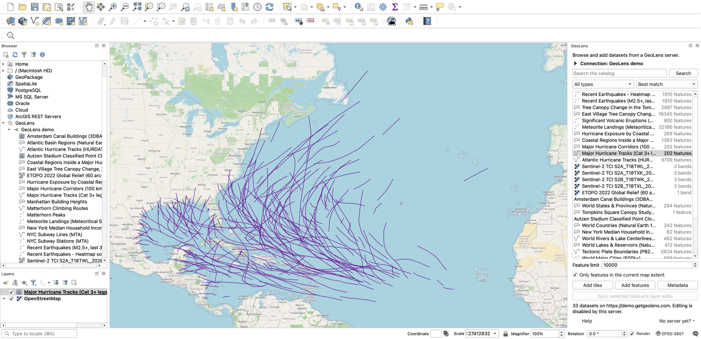

# GeoLens for QGIS

A QGIS plugin for browsing and using datasets from a GeoLens server. It brings the [GeoLens](https://github.com/geolens-io/geolens) catalog workflow from [GeoLibre](https://github.com/opengeos/GeoLibre) into QGIS.



*Basemap © OpenStreetMap contributors.*

## Features

- Keep several saved connections, each with its own server URL and authentication. Add the public GeoLens demo or the GeoLibre datasets server as an anonymous connection from the sample list. Private data uses an API key kept in the QGIS authentication database, or pasted for one session.
- Search the catalog, filter by vector or raster, and sort by best match, title or newest. Each row shows its feature or band count, and hovering shows a quicklook preview.
- Add vector datasets as signed Mapbox Vector Tile layers with automatic token renewal.
- Add raster datasets as server-rendered XYZ tile layers.
- Load vector datasets through OGC API Features, optionally clipped to the current map extent.
- Added layers carry the dataset's title, description, keywords, licence, extent and a link to its GeoLens page in their QGIS layer metadata.
- Open a dataset's GeoLens metadata page.
- Find datasets in the QGIS Browser panel under GeoLens, listed by saved connection. Double-click or drag one onto the map to add its tiles, or right-click to add editable features or open its metadata page.
- Edit loaded feature layers in QGIS and synchronize creates, updates, and deletes back to GeoLens when the server permits editing. Sync sends only the fields you changed, stops if the dataset was re-imported on the server, and reports fields you removed instead of clearing them on the server.
- Open the About dialog from **Web → GeoLens**. The interface is translated into Spanish, French, German and Chinese.

## Install

In QGIS 3.44 through 4.x, open **Plugins → Manage and Install Plugins**, search for **GeoLens** and click **Install Plugin**. Open it from **Web → GeoLens** or the toolbar. The plugin's listing is at [plugins.qgis.org](https://plugins.qgis.org/plugins/geolens_qgis/).

## Install for development

Clone the repository and link its plugin directory into your active QGIS profile:

```bash
git clone https://github.com/geolens-io/qgis-geolens-plugin.git
cd qgis-geolens-plugin
python install.py
```

Restart QGIS, enable **GeoLens** in **Plugins → Manage and Install Plugins**, then open it from **Web → GeoLens** or the toolbar.

The default Linux profile is `~/.local/share/QGIS/QGIS3/profiles/default/python/plugins`. Override it when needed:

```bash
python install.py --plugin-dir /path/to/profile/python/plugins
```

## Usage

1. Pick a saved connection, or click **New** to add one with a name, a server URL and optional authentication. **Add a sample server…** adds the GeoLens demo or the GeoLibre datasets server.
2. Click **Connect**. For a private server, paste an API key first. Tick **Save API key in the QGIS authentication database** to keep it with the connection.
3. Search, filter and select a dataset.
4. Choose **Add tiles** for scalable viewing, or **Add features** for attributes and editing.
5. For an editable feature layer, commit QGIS edits, select that layer in the Layers panel, and click **Sync selected GeoLens layer edits**.

GeoLens writes are per-feature and are not transactional. The plugin reports partial failures and requires confirmation before deleting server features.

## Keys and authentication

Each connection has its own authentication configuration. In the connection dialog you can choose an existing configuration or paste an API key. A pasted key is saved as an API Header configuration (`X-Api-Key`) in the QGIS authentication database, encrypted with the QGIS master password, and the connection uses that configuration. A key pasted in the panel and not saved stays in memory for the QGIS session, for that connection only.

A key or configuration is sent only to the server it was saved for, matched by scheme, host and port. A configuration you create yourself needs its URL set to that server, or the connection won't use it. The connection dialog deselects a configuration that doesn't match the URL you enter, and selects it again if you change the URL back.

Earlier versions kept the key in plain text in the profile settings. Opening the GeoLens panel moves such a key into the authentication database, attaches it to a connection for the server it was saved with, and deletes the plain-text copy. QGIS may ask for your master password. If the move fails or you cancel the prompt, the key stays where it was and the panel tries again in your next QGIS session. Until then the panel fills the key in only for a connection to that server. A key saved without a server URL isn't moved; paste it again.

No key is written to a layer source or a project file. Private vector and raster tiles load with a short-lived signed token that the plugin renews while the layer is open. A saved project keeps the last token, which expires within minutes, so a reopened project shows private tiles again once you re-add the layer from the GeoLens panel.

## Development

Most tests need only PyQt6, which CI runs on Python 3.10 to 3.13 with a Qt stub in place of QGIS:

```bash
pip install PyQt6 pytest
python -m pytest tests -v
python -m compileall -q geolens_qgis
python package_plugin.py
```

Tests that need pytest-qgis are skipped there. CI runs the full suite with pytest-qgis inside the `qgis/qgis` images for QGIS 4.2 and the 3.44 LTR; the workflow pins each image by digest. To do the same locally:

```bash
docker run --rm -v "$PWD":/src:ro -e QT_QPA_PLATFORM=offscreen qgis/qgis:4.2.2 sh -c \
  'cp -r /src /w && cd /w && python3 -m pip install -q --break-system-packages pytest-qgis==5.0.1 && python3 -m pytest tests -q'
```

Use `qgis/qgis:3.44.14` for the LTR.

`python scripts/update_translations.py` refreshes the `.ts` files from the `tr()` calls and compiles the `.qm` files; it needs `lrelease`, so run it inside a `qgis/qgis` image.

The generated `dist/geolens_qgis-<version>.zip` has the directory layout expected by the QGIS Plugin Manager.

## Project structure

```text
geolens_qgis/
├── dialogs/
│   ├── geolens_dock.py      # Catalog, layer, and edit-sync panel
│   └── connection_dialog.py # New and edit connection dialog
├── i18n/                    # Spanish, French, German and Chinese translations
├── icons/                   # Toolbar and About SVG assets
├── browser.py               # GeoLens entries in the QGIS Browser panel
├── client.py                # Dependency-free GeoLens API client
├── connection.py            # Server, QGIS auth config and network transport
├── connections.py           # Saved connections and the 0.1.0 settings migration
├── i18n.py                  # tr() helper
├── layer_info.py            # QGIS layer metadata from a dataset record
├── plugin.py                # QGIS lifecycle, menu, toolbar and About dialog
├── metadata.txt
└── LICENSE
tests/                       # API, package, connection, sync and PyQt6 import tests
scripts/
├── update_translations.py   # Translation refresh and .qm build
└── upload_to_qgis_plugin_repo.py
install.py                   # Cross-platform development installer
package_plugin.py            # QGIS repository archive builder
.github/workflows/           # CI and release publishing
```

CI runs pre-commit, Bandit, the PyQt6 smoke tests and the QGIS suites.
Publishing a GitHub release builds and attaches the plugin archive; when QGIS
repository credentials are configured, the same workflow uploads it to
plugins.qgis.org.

## License

MIT
